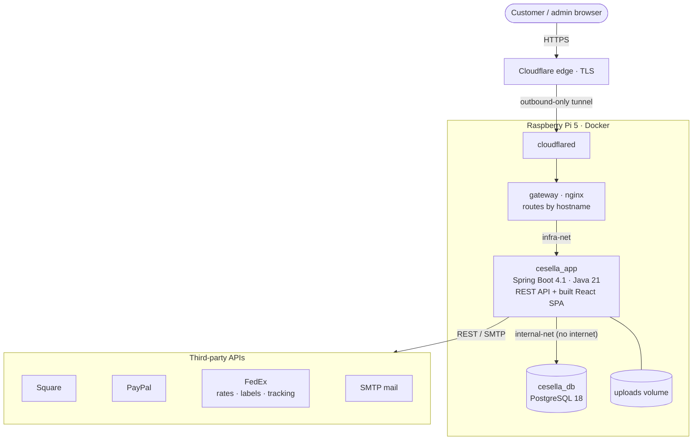

<!--
  garikcareer/cesella-case-study — a public, code-free write-up of the private cesella.com repository.
  Pin this repo on your profile. Add screenshots to docs/ and uncomment the Screenshots section.
-->

# Cesella · case study

**How I designed, built and run [cesella.com](https://cesella.com), a live US-only online perfume store.**

The source is private because this is a live store. I'm happy to walk through the code on a call: <a href="mailto:garikcareer@gmail.com">garikcareer@gmail.com</a>

Cesella pairs a React 19 + TypeScript storefront and admin panel with a Spring Boot 4.1 / Java 21 API on PostgreSQL 18, taking Square and PayPal payments and quoting live FedEx ground rates. It runs in production on a Raspberry Pi 5 behind a Cloudflare Tunnel, and every pull request has to pass a ten-step release gate — 2,400+ backend tests, 1,300+ frontend tests, an image smoke test, and vulnerability and secret scans — before it merges.

| **2,400+** | **1,300+** | **53** | **77** |
|:---:|:---:|:---:|:---:|
| backend tests — JUnit 5, MockMvc, Testcontainers PostgreSQL, ArchUnit | frontend tests — Vitest and React Testing Library | Flyway migrations, pinned by content hash and tested against existing data | REST endpoints, held to a committed OpenAPI contract |

<!-- Screenshots: add three images to docs/ with these names, then remove this comment's first and last lines.
## Screenshots

| Storefront | Checkout | Admin panel |
|:--:|:--:|:--:|
|  |  |  |
-->

## What it does

- **Storefront:** catalog with server-side search, filters and sorting, product variants, verified-buyer reviews with moderation, guest checkout and saved addresses.
- **Checkout:** Square and PayPal card payments, live FedEx ground rates (free standard shipping from $150), destination-based US sales tax.
- **After the sale:** FedEx labels and tracking, customer return requests, refunds, an earn-only loyalty program and transactional email.
- **Admin panel:** products, orders, users and roles, review moderation, email delivery, and customer privacy requests (export or erase).

## Architecture

| Layer | Technology | Notes |
|:--|:--|:--|
| **Frontend** | React 19, TypeScript 6, Vite 8, React Router 8 | Built into the Spring Boot jar and served by it; a bundle-size budget is checked on every build |
| **Backend** | Spring Boot 4.1, Java 21, Spring Security, JJWT | Modular monolith, package-by-feature: auth, product, order, payment, shipping, tax, review, user, mail, seo, site |
| **Data** | PostgreSQL 18 (production), H2 (development), Spring Data JPA / Hibernate, Flyway | `BigDecimal` money on the server, integer cents in the browser |
| **Integrations** | Square, PayPal, FedEx, SMTP | Sandbox or live endpoints come from the environment file, never from code |
| **Infrastructure** | Docker (multi-stage, digest-pinned bases), Docker Compose, Raspberry Pi 5 (arm64), Cloudflare Tunnel, nginx gateway | No inbound ports on the Pi; TLS ends at Cloudflare's edge |
| **Quality** | JUnit 5, MockMvc, Testcontainers, ArchUnit, Vitest, React Testing Library, ESLint, Prettier, Spotless, Trivy, gitleaks, Dependabot | One command runs the whole release gate |

## Engineering highlights

Each guarantee is enforced by a named test in the private repository.

| Area | Guarantee | Enforced by |
|:--|:--|:--|
| **Pricing integrity** | The server re-checks every price and total; a PayPal order is not created, or not captured, when its total changed | `PriceChangedCheckoutTest`, `CarrierPricedPaymentTest` |
| **Transaction boundaries** | No Square, PayPal, FedEx or SMTP call runs inside a database transaction, so a slow provider never holds a connection or a stock-row lock | `CarrierCallTransactionTest`, `PaymentIncidentsTransactionTest` |
| **Concurrency** | Stock decrements, row locks and unique indexes hold when two real transactions race, in every interleaving | `PostgresConcurrencyTest` |
| **Architecture** | Feature packages have no cycles, shared code depends on no feature, controllers own no transactions | `ArchitectureTest` (ArchUnit) |
| **Query performance** | List endpoints issue a bounded number of SQL statements however many rows a page holds | `ListEndpointsQueryCountTest` |
| **API contract** | The generated OpenAPI document is committed; any drift fails the build and shows up as a reviewed diff | `OpenApiSnapshotTest` |
| **Sessions and auth** | JWT in a hardened HttpOnly cookie with a CSRF double-submit check, login throttling and rate limits; production refuses to start without a stable signing key | `SessionCookieFlowTest`, `LoginThrottleTest`, `RateLimitFilterTest`, `JwtSecretInProductionTest` |
| **Migrations** | A shipped migration can never be edited; upgrades are tested on databases full of legacy rows | `MigrationManifestTest`, `PostgresMigrationOnDataTest` |
| **Container hardening** | Bases pinned by digest; the app runs read-only and non-root with every capability dropped; PostgreSQL never receives payment or mail keys | `ComposeHardeningTest`, `ContainerImageTest`, `PostgresVolumeGuardTest` |
| **Recovery** | Nightly encrypted backups, a monthly restore drill, and release barriers that stop an older release from starting on a newer schema | `PostgresBackupScriptsTest`, `PostgresReleaseBarrierTest` |

## Delivery and operations

- **Release gate:** one command runs ten steps and stops at the first failure: a clean full-history clone, verified Gradle wrapper checksums, the backend build with every test (PostgreSQL tests required), the frontend typecheck, lint, format, tests, build, size budget and dependency audit, the production image and its smoke test, a Trivy image scan, a gitleaks scan of the whole history, and the Compose and gateway configs.
- **Production:** Docker Compose on a Raspberry Pi 5. The database sits on an internal network with no internet access; the app container is read-only with every Linux capability dropped; both have memory caps, bounded logs and health checks, so a fault restarts one container instead of taking down the Pi.
- **Dependencies:** weekly Dependabot updates across Gradle, npm, Docker and Compose, with base images pinned by digest.

---

Built and operated by <a href="https://github.com/garikcareer">Garik Arutyunyan</a> · <a href="https://garikcareer.com">garikcareer.com</a>

